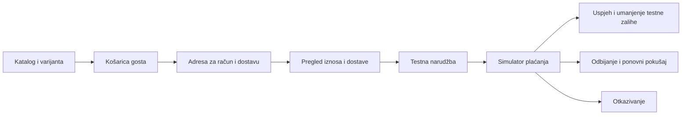

# Razvojna kupnja i demo podaci

Ova faza daje funkcionalnu **razvojnu** trgovinu s katalogom, košaricom, dostavom, narudžbom i simulatorom plaćanja. Nema stvarnog terećenja kartice, slanja paketa, fiskalizacije ni slanja digitalnih prava. Korisnik je izričito odgodio sigurnosni pregled naplate/zaliha s Astrom i uključivanje stvarnih procesora do jutra.

## Pregled

- Trgovina: `http://192.168.250.2:8080/`
- Prijava administratora: `http://192.168.250.2:8080/admin/login`
- Administracija: Proizvodi, Opcije, Kategorije, Dostava, Narudžbe, Plaćanja i privatne Digitalne datoteke.
- Lozinke i ključevi nisu dio repozitorija ni ove dokumentacije.
- Stabilni IP i HTTP put kupnje provjereni su iz Ubuntu VM-a. Dostupnost iz Windows preglednika u ovoj fazi nije neovisno provjerena.



## Izričito postavljanje testne instance

Nakon instalacije paketa, migracija i izgradnje frontenda u `local` okolini:

```bash
php artisan oneshop:initialize
php artisan oneshop:demo-catalog
php artisan oneshop:demo-shipping
```

Postaviti `ONESHOP_DEMO_CHECKOUT=true` u privatnom `.env`, zatim `php artisan config:clear` (ili ponovno izgraditi produkcijski cache pri deployu). Uobičajeni primjer `.env.example` ima `false`. Simulator u servisu dodatno provjerava da je okolina isključivo `local` ili `testing`; `production` ga odbija i uz uključenu zastavicu. Ne koristiti promjenu `APP_ENV` kao način otvaranja simulatora na javnoj produkciji.

Demo katalog zahtijeva prazan katalog bez postojeće porezne konfiguracije. Dodaje tri proizvoda i šest SKU-ova: Majica Osnova u dvije boje i dvije veličine, Šalica Jutro i Torba Svaki dan. Testni porez od 25% i HR dostava od 5 EUR s tim porezom služe provjeri računanja. Nisu potvrđena poslovna pravila trgovca. Ponovni seed čuva postojeće proizvode, tarife i zalihu; ne služi resetiranju demo kupnji.

Ilustracije su vlastiti statički SVG resursi u `public/images/demo`. Upload SVG-a od trgovca nije omogućen; galerija prihvaća samo provjerene JPEG/PNG/WebP slike. Javni katalog koristi objavu, kanal, raspored i odabranu grupu kupaca. Nacrti i privatne digitalne datoteke nisu javne slike.

## Što tok radi

Košarica ima ID samo u sesiji, odvojen od administratorskog korisnika. Cijene, valuta i pripadnost stavki dolaze s poslužitelja. Obrazac kupca ne određuje iznos, korisnika, ID tuđe košarice ni cijenu dostave. Količine su 1–99, najviše 50 različitih stavki.

Unos jedne adrese koristi se za račun i dostavu. Ovo je početni MVP; odvojena adresa i B2B podaci još nisu uključeni u javni obrazac. Dostava se bira među aktivnim metodama za državu te ponovno računa kroz Lunar porezni sustav. Dostava se može promijeniti prije predaje. Nema poziva stvarnom dostavljaču ili izmišljene tvrdnje o roku isporuke.

Pregled prikazuje porez, dostavu i konačan iznos. Potvrda koristi provjeru sadržaja košarice, adresa i iznosa. Promjena cijene ili tarife traži novi pregled; posted `total` se ne koristi. Narudžba čuva stavke i adrese kao povijesne vrijednosti. Ponovna predaja iste košarice vraća istu testnu narudžbu.

Simulator je zasebna stranica, vezana uz istu sesiju i nepredvidiv identifikator, s CSRF zaštitom na promjenama. GET parametri poput `paid=1` ne potvrđuju plaćanje. Ishodi su uspjeh, odbijanje i otkazivanje. Uspjeh zapisuje transakciju `oneshop-demo` i jednom umanjuje praćenu zalihu pod zaključavanjem redaka. Ponovljeni zahtjev ne zapisuje novu uspješnu transakciju. Odbijanje dopušta ponovni pokušaj unutar 30 minuta. Otkazivanje i istek ne mijenjaju zalihu.

**Nema rezervacije zalihe tijekom čekanja.** Simulator ponovno provjerava zalihu pri potvrdi i odbija ishod uspjeha ako više nema količine. To je odvojeno od budućeg procesa u kojem vanjski pružatelj može već naplatiti novac; takav slučaj zahtijeva rezervacije, webhook obradu i usklađivanje te pripada odgođenom pregledu. Simulator se ne smije preimenovati ili uključiti kao produkcijski procesor.

Povijest pokušaja nalazi se u administraciji Plaćanja; testne transakcije i narudžbe imaju vidljivu oznaku. Administracija ne izlaže sirovi payment payload niti nudi ručno proglašavanje stvarne naplate ili povrat novca.

## Što ostaje za jutro

- Astra sigurnosni pregled produkcijskih rezervacija zalihe, idempotentnog poravnanja, webhook potpisa i iznosa/valute, ponovljenih i zakašnjelih događaja.
- Trgovčev odabir i računi stvarnih procesora, testni ključevi i potvrđeno testiranje kod pružatelja. Trenutačno nijedan Stripe/PayPal adapter nije uključen.
- Trgovčeva pravila poreza, država, dostavnih tarifa, stvarni dostavljači i način predaje pošiljke.
- Pravna identifikacija trgovca, uvjeti kupnje, privatnost, računi/fiskalizacija i politika povrata.
- Dodjela prava na digitalne datoteke nakon stvarno potvrđenog plaćanja.

Ovo nisu potvrđeni zahtjevi niti odluke koje je agent donio u ime trgovca. Ne blokiraju testiranje ostatka razvojnog MVP-a.
